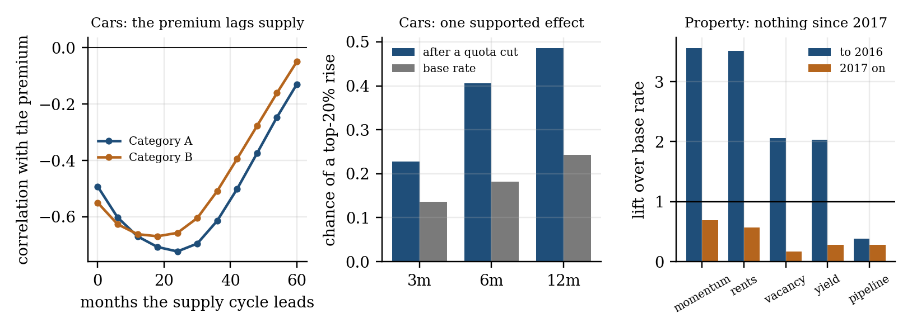
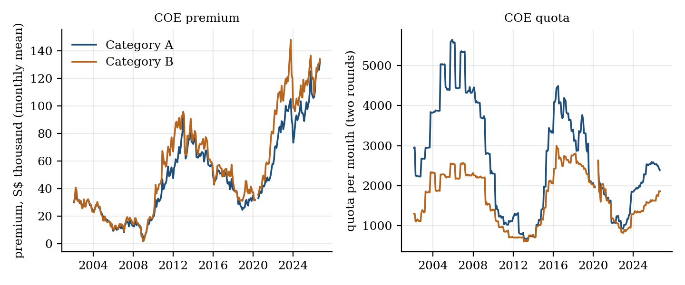
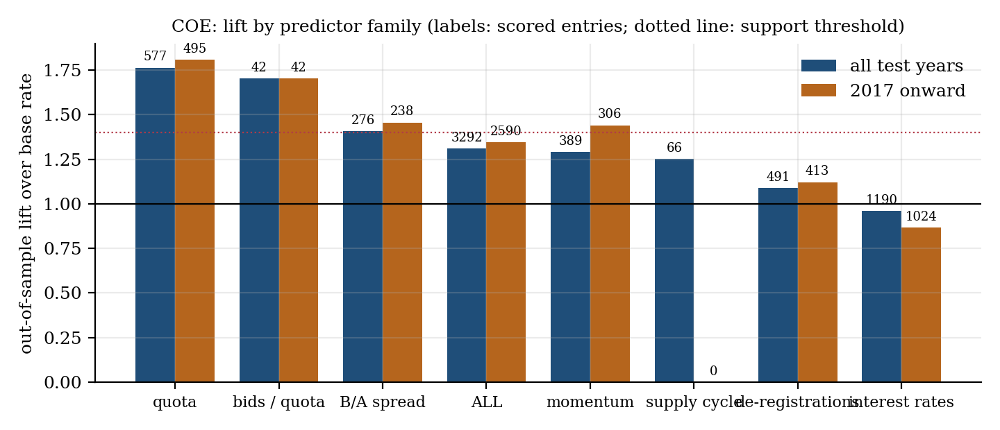
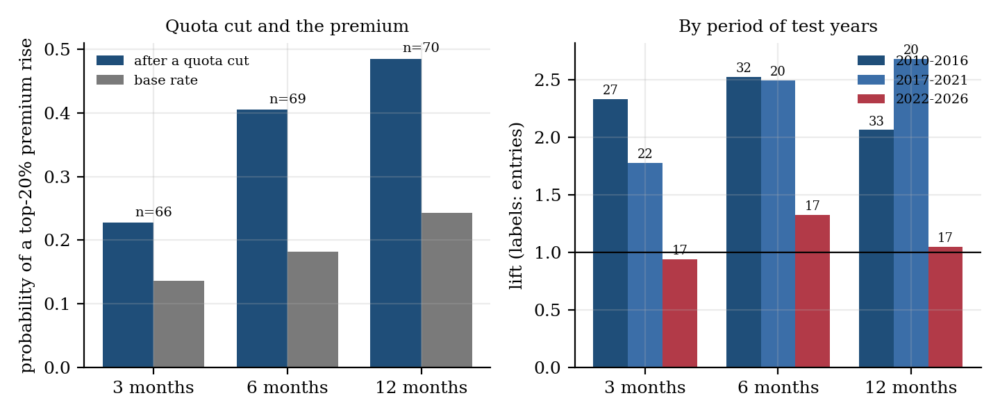
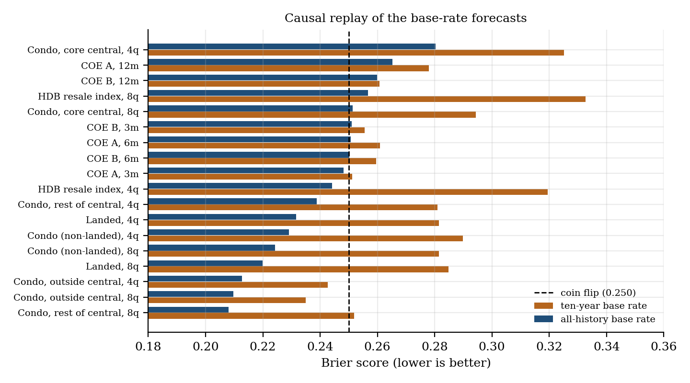

# The Ten-Year Echo in Singapore's COE Premium, and Why Housing Timing Signals Fail Out of Sample

By Arun Ramanathan

CPE research series, Paper 18

---

## Graphical Abstract

*Left, the premium lags the supply cycle by 18 to 24 months. Middle, after a quota cut the premium is in its top 20% of moves far more often than normally (both categories, thresholds from past data only). Right, every private-property predictor that worked up to 2016 has a lift near or below 1 since 2017. Built by `paper/paper_figures.py`.*

---

## Abstract

When to buy a car or a home in Singapore is a timing question with public data behind it. This paper applies one disciplined test to both: mechanisms written down before testing, thresholds that use only information available at the time (a causal walk-forward), and a rule that a signal counts as supported only if it holds both over all test years and since 2017. The data are 296 months of Certificate of Entitlement (COE) results from February 2002, private property price indices from 1975 and the HDB resale price index from 1990.

For cars, one mechanism is supported. A COE lasts ten years, so registrations become scheduled expiries; since 2018 the schedule tracks de-registrations (correlation 0.96), de-registrations set the quota, and the premium follows the supply cycle with a lag of 18 to 24 months (correlation -0.72 for Category A and -0.67 for Category B). After a quota cut, the premium was in its top 20% of six-month rises 41% of the time against 18% (lift 2.23), robust to every tail threshold tried. The effect is strong to 2021 and not detected from 2022 on (17 entries), after the quota formula changed; very few cuts have occurred since.

For property, nothing is supported: the walk-forward lift of the admitted conditions is 0.96 overall and 0.64 since 2017, and the 2008-2010 momentum effect, the largest single result, is absent since 2017. A ten-year base rate scores worse than a coin flip for property and no better than one for the COE premium; the all-history base rate beats the coin for property. The design and a forward ledger, which logs base-rate forecasts and scores them as outcomes arrive, are fixed here before the first outcome.

---

## Plain Language Summary

Singapore's car ownership permits (COEs) and its property prices are the two big purchase decisions where timing seems to matter. We tested every timing idea we could write down in advance, using public data: 296 months of COE results, private property prices back to 1975 and HDB resale prices back to 1990. Each idea was judged only on information that existed at the time, and an idea counted as real only if it worked both over the whole record and in the most recent decade.

For cars we found one real pattern. A COE lasts ten years, so the cars registered a decade ago come up for renewal or scrapping now. That wave of expiring permits drives how many permits the government releases, and the price of a permit follows that supply with a delay of about a year and a half to two years. After the government cut the quota, the permit price jumped sharply within six months about 41% of the time, compared with 18% normally. The pattern held up under every variation we tried, but it was strong until 2021 and we cannot detect it since, partly because the quota rules changed and there have been very few cuts to test.

For property we found nothing that works. Ideas that predicted prices well before 2017, such as recent price momentum, rents and interest rates, have not worked since. The last ten years rose almost without a pause, so a rule of thumb built on that decade is a worse guide than the long history; for property, the long-run odds of a rise beat a coin flip, while the ten-year odds do worse than one. For permits the odds are roughly a coin flip either way. Condo prices have fallen by 47%, 42% and 26% in past downturns.

We publish the rules now, before the results are known, and a public dashboard keeps a ledger that logs its own forecasts and scores them as outcomes arrive, starting October 2026. This is research, not advice.

---

## 1. Introduction

Two purchases dominate the Singapore household balance sheet: a car, which first requires a Certificate of Entitlement (COE), and a home, public or private. Both have public price histories and a standing belief that timing matters: the COE premium is said to move with quota announcements, and property is said to follow momentum, interest rates and supply. This paper asks which of these beliefs survive a test that cannot cheat, and what a buyer should use in their place.

The test is the conditional-exceedance (CPE) framework of this series (Ramanathan, 2026), applied with three disciplines. Each predictor carries a mechanism written down before it is tested. Every threshold and every admission decision uses only information resolved before the year being scored (a causal walk-forward). And a predictor counts as supported only if its out-of-sample lift over a season-matched base rate is at least 1.4 over all test years and also since 2017, on at least 100 scored entries. The third rule is the one that matters most here: it removes effects that depend on a single cycle.

The paper has four findings.

1. **A ten-year echo drives the COE premium.** The ten-year life of a COE turns past registrations into a schedule of expiries, which tracks de-registrations, which set the quota; the premium lags that supply cycle by 18 to 24 months (Section 4.2).
2. **One condition is supported for cars, with a caveat.** After a quota cut the premium is more often in its largest rises over the following three to twelve months. The effect is robust to thresholds, strong through 2021 and not detected since 2022, when the quota formula changed and cuts became rare (Section 4.4).
3. **No timing condition is supported for property.** The momentum effect that scored a lift above 3 up to 2016 scores below 1 since 2017, and rents, rates and vacancy follow the same pattern; the same holds for the HDB resale index (Section 5).
4. **The base rates a buyer would reach for are not equally reliable.** Replayed causally, the ten-year base rate for the COE premium scores about as well as a coin flip, and for property it scores worse; the all-history base rate beats the coin for property (Section 6).

Section 7 fixes the forward test: a ledger that logs the dashboard's base-rate forecasts and any active supported condition, and scores them as outcomes arrive. Section 8 lists the choices that were made after seeing results.

## 2. Data

### 2.1 The quota system and the premium

Singapore caps the vehicle population through a Vehicle Quota System. A COE is a ten-year entitlement to own a vehicle, sold in uniform-price auctions twice a month; the premium is the price at which the quota clears. The quota for each quarter is announced in advance. From August 2022 it was set from the previous two quarters' de-registrations, and from February 2023 from the previous four (LTA, 2022; LTA, 2023). The series used here are Category A (cars up to 1,600cc and 97kW) and Category B (above), under the definitions in force before May 2022, as monthly means of the two rounds.

### 2.2 Sources

| Series | Source | Coverage used |
|---|---|---|
| COE quota, bids and premium by category | LTA, data.gov.sg | February 2002 to September 2026 (296 months) |
| New registrations and de-registrations by category | LTA, data.gov.sg | monthly from 1990 |
| Two-year government yield, SORA | MAS, data.gov.sg | monthly |
| Private residential price and rental indices (landed, non-landed, by region) | URA, data.gov.sg | quarterly from 1975 (regions from 2004) |
| Transactions, launches, sales, supply pipeline, vacancy, unsold approved units | URA, data.gov.sg | quarterly, 1988 to 2026 Q2 depending on series |
| HDB Resale Price Index | HDB, data.gov.sg | quarterly from 1990 |

All series are public and fetched by code; Section 10 lists the repository.

## 3. Method

### 3.1 Conditional exceedance and its base rate

For a predictor X observed over the past τp periods and a target Y measured over the next τf periods, the conditional probability of exceedance is the probability that Y falls in a tail event set when X is in its own tail, and the lift divides it by a base rate:

(1)

The base rate is season-matched: for each scored entry i, the frequency of the same Y event over all test-window entries in the same calendar month (or quarter) m(i), averaged over the n scored entries:

(2)

For the COE premium Y is the forward change in the log monthly premium over 3, 6 and 12 months, and the event is the top 20% of changes; for the price indices Y is the forward change over 1, 2, 4 and 8 quarters. X tails are the 20% and 10% tails.

### 3.2 Registered predictors

Each family has a direction fixed in advance by its mechanism. For the COE premium: quota change over the past τp months (more supply, lower premium); de-registrations, lagged two months for publication, against their 12-month mean (more de-registrations feed later quota); bids per quota (demand pressure); the change in the two-year government yield (dearer financing); the premium against its trailing 12-month mean (reversion); the Category B/A spread (convergence); premium momentum (continuation); and the supply cycle, the change in the 12-month mean of de-registrations measured 6, 12 or 18 months ago. For property and the HDB index: own momentum; rent growth; the two-year yield; the supply pipeline; units transacted; unsold approved units; vacancy against its five-year mean; new sales per launch; price-to-rent against its five-year mean; and, for the HDB index, private outside-central momentum and the HDB-to-private ratio. Quarterly statistics other than prices, rents and yields enter with a one-quarter lag.

### 3.3 Causal walk-forward and the support rule

For each test year y from 2010 (cars) or 2005 (property) or 2000 (HDB index), the X and Y thresholds and the admission of conditions use only entries whose outcome was resolved before 1 January of y. A condition c is admitted if its training lift is at least 1.5, it has at least 20 entries, and the entries form at least four episodes (entries more than τf apart):

(3)

Admitted conditions are scored on that year's entries, and results are pooled across years. A predictor family f is called supported only if

(4)

where Lfall is its pooled lift over all test years, Lf&ge;2017 its pooled lift over test years from 2017, and nf its number of scored entries.

### 3.4 Scoring base-rate forecasts

The dashboard's base rate for a series and horizon is the share of recent (the last ten years) or all earlier windows in which the series was higher after the horizon, counting only windows already finished at the anchor. Its accuracy is the Brier score, where pi is the forecast probability and oi the outcome:

(5)

A constant forecast of one half scores 0.250; lower is better.

### 3.5 Overlap and effective sample

Every month or quarter is an entry, so entries overlap. Counts of scored entries are reported with the number of non-overlapping τf windows they correspond to, as a guide to how much independent evidence stands behind a result.

## 4. Cars: the COE premium

### 4.1 The premium and the quota

The Category A premium fell from S$30,000 in February 2002 to a trough of S$2,740 in February 2009, rose to a smoothed peak of S$75,083 (May 2013), fell to S$28,003 (March 2019) and reached S$132,450 in September 2026; Category B stood at S$134,000. Two features matter for what follows: the premium moves in long swings around a rising trend, and the quota moves in the opposite direction with a delay.

### 4.2 The ten-year echo

The smoothed Category A premium troughs in January 2009 and March 2019 and peaks in 2013; the periodogram of the detrended log premium peaks at 11.6 years for both categories, with autocorrelation of 0.55 at ten years and 0.82 at twelve (Category A). That is two cycles in 24.7 years, so the period is an estimate and not a finding.

A mechanism explains a swing of this length. A COE lasts ten years, so the registrations of month t &minus; 120 are a schedule of expiries for month t. Writing N for registrations, E for scheduled expiries and S for their 12-month mean,

(6)

The schedule tracks de-registrations closely in the recent record: the correlation of S with the 12-month mean of de-registrations is 0.33 in 2000-2009, 0.72 in 2010-2017 and 0.96 in 2018-2026. The echo is regime-dependent: on monthly data over the whole record, the correlation of de-registrations with registrations 120 months earlier is 0.01, and the strongest relation is at lag zero (0.78); it appears in the 12-month means only from 2010. A possible reason for its weakness in the 2000s is that renewals and early scrapping blurred it, which is not tested here. De-registrations in turn set the quota (correlation of 12-month means 0.93), and since 2023 the quota is set from a four-quarter average of de-registrations.

The premium lags this supply cycle. The correlation of the detrended log premium with de-registrations k months earlier is most negative at 24 months for Category A (-0.72) and 18 months for Category B (-0.67), and at 18 months it is -0.71 (2002-2013) and -0.88 (2014-2026) for Category A and -0.69 and -0.86 for Category B. Scheduled expiries average 6,770 vehicles a month over the past year and 7,573 over the coming year, against 5,181 actual de-registrations over the last twelve months, so the quota is set to keep rising through 2027 to 2028. At an 18 to 24 month lag that implies easing premium pressure from 2027, but the premium reached record levels in 2024-2026 while de-registrations were already rising, so demand or a longer lag overrides the supply cycle for now. This is a description of where the market sits in the cycle; it is not a forecast of a turning point.

### 4.3 Walk-forward results

The walk-forward admits 848 condition-years (3,292 scored entries): CPE 0.178 against a base of 0.136, a pooled lift of 1.31. Table 1 gives the families.

| Family | Lift, all test years (entries) | Lift, 2017 onward (entries) | Supported |
|---|---|---|---|
| Quota change | 1.76 (577) | 1.81 (495) | yes |
| Category B/A spread | 1.41 (276) | 1.46 (238) | yes |
| Premium momentum | 1.29 (389) | 1.44 (306) | no |
| Lagged supply cycle | 1.25 (66) | n/a | no |
| De-registrations | 1.09 (491) | 1.12 (413) | no |
| Two-year yield | 0.96 (1190) | 0.87 (1024) | no |
| Bids per quota | 1.70 (42) | 1.70 (42) | no |

*Table 1. COE walk-forward by predictor family. The quota-implied fair-value predictor is excluded (see Section 8).*

Quota change and the Category B/A spread meet the support rule. Interest rates, short-run de-registrations and momentum add little, and bids per quota rests on 42 entries. By horizon the pooled lift is 0.93 at one month, 1.12 at three, 1.52 at six and 1.72 at twelve: the supported effect builds slowly. The lagged supply-cycle family, registered after the lag was found (Section 8), was admitted in only 66 entries and scores 1.25; the cycle is a description, not a validated predictor of tail moves.

### 4.4 The quota-cut effect and its robustness

Without any admission filter, a quota cut is the bottom 20% of the past six-month change in log quota, with thresholds from entries resolved before the test year. At three, six and twelve months the premium was in its top 20% of moves 23%, 41% and 49% of the time after a cut against base rates of 14%, 18% and 24%: lifts of 1.67, 2.23 and 2.00 on 66, 69 and 70 entries, which correspond to about 22, 12 and 6 non-overlapping windows.

The result does not depend on the thresholds. Across cut tails of 10%, 20% and 30%, premium-move tails of 10%, 20% and 30%, and the three horizons, the lift ranges from 1.41 to 3.54; every one of the 27 combinations exceeds 1.4.

It does depend on the period (Table 2). The six-month lift is 2.53 in 2010-2016 and 2.50 in 2017-2021, and 1.33 in 2022-2026 on 17 entries (0.94 and 1.05 at three and twelve months). Only two of those entries fall in 2023-2026: the quota has risen almost continuously since 2023, so quota cuts have been rare. The recent period is therefore untested more than contradicted, but the effect is not detected there, and the quota formula changed in August 2022 and February 2023 (Section 2.1), which would reduce the surprise in quota moves.

| Test years | 3 months | 6 months | 12 months |
|---|---|---|---|
| 2010-2016 | 2.33 (27) | 2.53 (32) | 2.07 (33) |
| 2017-2021 | 1.78 (22) | 2.50 (20) | 2.68 (20) |
| 2022-2026 | 0.94 (17) | 1.33 (17) | 1.05 (17) |

*Table 2. Quota-cut lift (entries) by period of test years, both categories, cut tail 20%, premium-move tail 20%.*

A regression gives the same direction. Regressing the forward 12-month log premium change on the past six-month log quota change, with Newey-West standard errors (12 lags) over 269 months, the slope is -0.47 (t = -2.8) for Category A and -0.81 (t = -3.3) for Category B. Splitting the change into cuts and increases,

(7)

the cut coefficient β&minus; is -0.81 (t = -2.5) for Category A and -1.61 (t = -2.9) for Category B, while the increase coefficient β+ is -0.16 (t = -0.5) and -0.21 (t = -0.5): the effect is one-sided. A quota increase is not followed by a lower premium on this evidence.

### 4.5 What the cars results do not show

The quota is announced a quarter ahead and, since 2023, follows a published rule, so the market can compute it; the result says the premium reacts slowly to a known variable, not that the quota surprises. There are two supply cycles in the record. The Category A premium was higher after three months in 61% of windows, so a buyer who waits has more often faced a higher premium; Section 6 tests whether that tendency is reliable enough to forecast with.

## 5. Property

### 5.1 Private residential prices

The property walk-forward covers five targets (all non-landed, landed and the three regions of the non-landed index) at horizons of one to eight quarters. It admits 1,622 condition-years and 3,072 scored entries: CPE 0.140 against a base of 0.145, a lift of 0.96 overall and 0.64 since 2017. No family meets the support rule (Table 3).

| Family | Lift, all years (entries) | Lift, to 2016 | Lift, 2017 onward (entries) |
|---|---|---|---|
| Price momentum | 2.13 (532) | 3.56 | 0.69 (174) |
| Rent growth | 1.20 (457) | 3.51 | 0.57 (315) |
| Two-year yield | 0.52 (856) | 2.03 | 0.28 (651) |
| Vacancy rate | 0.76 (158) | 2.06 | 0.17 (94) |
| Units transacted | 0.81 (622) | 0.51 | 0.83 (586) |
| Supply pipeline | 0.35 (229) | 0.38 | 0.28 (74) |
| Unsold approved units | 1.38 (101) | n/a | 1.38 (101) |
| New sales per launch | 1.13 (79) | n/a | 1.13 (79) |
| Price-to-rent | 0.31 (38) | n/a | 0.31 (38) |

*Table 3. Private property walk-forward by predictor family.*

Price momentum scores 3.56 up to 2016, driven by the 2008-2010 swings, and 0.69 since 2017, on 174 entries. Rent growth, the two-year yield and vacancy show the same shape: lifts between 2.0 and 3.5 to 2016 and below 1 since. A pooled statistic that included the earlier years alone would have suggested momentum as a timing tool; the since-2017 requirement of the support rule is what removes it.

### 5.2 The HDB resale price index

The same design applied to the HDB resale index from 1990 admits 474 condition-years and 970 entries: a lift of 0.82 overall and 0.28 since 2017. Own momentum scores 5.08 on 63 entries, of which 3 are since 2017; rates, rents and vacancy score between 1.4 and 2.1 to 2016 and between 0.0 and 0.1 since (Table 4). The index has moved sideways for four quarters, at 202.8 in 2026Q2, 0.4% below its 2025Q3 peak.

| Family | Lift, all years (entries) | Lift, to 2016 | Lift, 2017 onward (entries) |
|---|---|---|---|
| HDB momentum | 5.08 (63) | 5.19 | 0.00 (3) |
| Private (outside central) momentum | 0.33 (43) | n/a | 0.33 (43) |
| Two-year yield | 0.40 (409) | 1.35 | 0.11 (281) |
| Rent growth | 0.61 (212) | 2.10 | 0.14 (142) |
| Vacancy rate | 0.96 (111) | 2.12 | 0.00 (58) |
| Units transacted | 0.63 (130) | 0.00 | 0.70 (111) |
| Supply pipeline | 0.00 (2) | 0.00 | n/a (0) |

*Table 4. HDB resale index walk-forward by predictor family.*

### 5.3 Base rates and past falls

| Series | Window | Lower after 4 quarters | Median, 4 quarters | Lower after 8 quarters | Median, 8 quarters |
|---|---|---|---|---|---|
| Non-landed | since 2004 | 23% | +4.4% | 21% | +7.6% |
| Non-landed | last 10 years | 6% | +4.8% | 0% | +9.7% |
| Landed | since 2004 | 27% | +4.2% | 20% | +8.7% |
| Landed | last 10 years | 14% | +5.8% | 0% | +9.3% |
| HDB resale index | since 1990 | 32% | +4.9% | 33% | +9.3% |
| HDB resale index | since 2004 | 33% | +4.9% | 34% | +12.5% |
| HDB resale index | last 10 years | 28% | +5.2% | 22% | +13.4% |

*Table 5. How often each index was lower after four and eight quarters, and the median change.*

The last decade was almost one-way: the non-landed index was lower four quarters later in 6% of windows, against 23% since 2004, and the worst four-quarter change since 2004 was 30% down. Table 6 lists the falls of more than 10% (more than 5% for the HDB index) from a peak.

| Series | Peak | Trough | Fall | Quarters down | Quarters to recover |
|---|---|---|---|---|---|
| Non-landed | 1981Q2 | 1986Q2 | -47% | 20 | 20 |
| Non-landed | 1996Q2 | 1998Q4 | -42% | 10 | 36 |
| Non-landed | 2008Q2 | 2009Q2 | -26% | 4 | 4 |
| Non-landed | 2013Q3 | 2017Q2 | -10% | 15 | 9 |
| Landed | 1984Q1 | 1986Q2 | -34% | 9 | 13 |
| Landed | 1996Q2 | 1998Q4 | -48% | 10 | 47 |
| Landed | 2013Q3 | 2017Q2 | -16% | 15 | 15 |
| HDB resale index | 1996Q4 | 2002Q1 | -30% | 21 | 26 |
| HDB resale index | 2013Q2 | 2019Q2 | -12% | 24 | 9 |

*Table 6. Falls from a peak.*

## 6. Scoring the base rates

A buyer without a signal reaches for a base rate. How good is it? Replaying the forecast causally (Section 3.4) over every anchor with a known outcome, for the two COE series at 3, 6 and 12 months and the six property series at 4 and 8 quarters, gives Figure 6 and Table 7.

| Series | Horizon | Windows scored | Share actually higher | Brier, ten-year | Brier, all-history |
|---|---|---|---|---|---|
| COE A | 3 months | 170 | 61% | 0.251 | 0.248 |
| COE A | 6 months | 167 | 58% | 0.261 | 0.251 |
| COE A | 12 months | 161 | 55% | 0.278 | 0.265 |
| COE B | 3 months | 170 | 57% | 0.256 | 0.251 |
| COE B | 6 months | 167 | 57% | 0.260 | 0.250 |
| COE B | 12 months | 161 | 52% | 0.261 | 0.260 |
| Condo (non-landed) | 4 quarters | 162 | 70% | 0.290 | 0.229 |
| Condo (non-landed) | 8 quarters | 158 | 73% | 0.281 | 0.224 |
| Landed | 4 quarters | 162 | 67% | 0.281 | 0.232 |
| Landed | 8 quarters | 158 | 72% | 0.285 | 0.220 |
| Condo, core central | 4 quarters | 46 | 59% | 0.325 | 0.280 |
| Condo, core central | 8 quarters | 42 | 69% | 0.294 | 0.251 |
| Condo, rest of central | 4 quarters | 46 | 70% | 0.281 | 0.239 |
| Condo, rest of central | 8 quarters | 42 | 81% | 0.252 | 0.208 |
| Condo, outside central | 4 quarters | 46 | 76% | 0.243 | 0.213 |
| Condo, outside central | 8 quarters | 42 | 81% | 0.235 | 0.210 |
| HDB resale index | 4 quarters | 102 | 66% | 0.319 | 0.244 |
| HDB resale index | 8 quarters | 98 | 64% | 0.333 | 0.257 |

*Table 7. Causal replay of the base-rate forecasts.*

For the COE premium the mean Brier score is 0.261 for the ten-year base rate and 0.254 for the all-history rate: about a coin flip. For the property series the ten-year rate scores 0.285, worse than a coin, and the all-history rate 0.234, better. A trailing decade over-reacts to the regime just before it; the long history is the better guide for property, and for the COE premium neither window forecasts the direction usefully.

## 7. A registered forward test

The dashboard (https://quantarram.github.io/sg-buy-timing-dashboard/) fixes the following before any outcome resolves. Each month (COE) or quarter (property, HDB) it logs the ten-year and all-history base-rate forecasts that the series will be higher after each horizon (3, 6 and 12 months; 4 and 8 quarters). It logs a condition as an entry the first time a supported family is active in its supported tail, today only a quota cut for the COE premium. It scores a forecast as the Brier contribution and an entry as the direction of the move against its implied direction, at each horizon, and publishes both, whatever the result. The first 18 forecasts were logged on 16 October 2026; the earliest outcomes, at three months, arrive once the December 2026 COE data are published. The dashboard's verdict is WAIT AND WATCH unless a supported condition is active, and a verdict other than wait and watch is a statement about conditions and base rates, not a recommendation.

## 8. Limits and choices made after seeing results

- **Few independent episodes.** There are two COE supply cycles in 24.7 years and about six property price cycles in the longer record. The quota-cut effect rests on about 12 non-overlapping six-month windows.
- **A period dependence.** The quota-cut effect is not detected from 2022 (17 entries), after the quota formula changed in August 2022 and February 2023; very few cuts have occurred since. The effect is a pre-2022 finding with an untested present.
- **Choices made after seeing results.** The lagged supply-cycle family was registered after the 18 to 24 month lag was found in the descriptive analysis, so it is out of sample only in the walk-forward years. The requirement that a family also hold since 2017 was added after the property results showed the 2008-2010 effects fading. The quota-implied fair-value predictor was dropped for a specification problem: premiums trend upward for reasons other than quota, so its residual sits at an extreme in every recent month. The 2017 break point was chosen as the start of the latest decade, not tuned.
- **A hypothesis, not a finding.** Policy measures from December 2011 (the Additional Buyer's Stamp Duty; MAS, 2011) may have changed how property prices behave, which would explain why pre-2017 relationships fail. This is untested here.
- **Scope.** Public data only; prices, not transaction costs, loans, stamp duties or the cost of waiting; premiums as monthly means of two rounds, not individual bids; nothing is specific to any one flat or car.
- **Not advice.** The paper and the dashboard describe conditions and base rates. They do not recommend a purchase or a sale.

## 9. Conclusion

Timing a Singapore car purchase has one supported mechanism, a quota cut followed by a rising premium, rooted in the ten-year life of a COE, strong to 2021 and not detected since the quota rule changed. Timing a property purchase or sale has none: what predicted prices in 2008-2010 has not worked since 2017, for private property and for HDB alike. The practical content is in the base rates and the history: the long-run odds of a rise are better than the last decade's for property, the COE premium's tendency to rise is no better than a coin flip as a forecast, and past property downturns were deep. Whether the supported effect returns, and how well the dashboard's own forecasts score, will be answered by the forward ledger and not by this paper.

## 10. Code and data availability

The dashboard, data fetchers, research code, forward ledger and this paper's build scripts are in the public repository `quantarram/sg-buy-timing-dashboard`: `research/coe_cpe_walkforward.py`, `research/property_cpe_walkforward.py`, `research/hdb_rpi_cpe_walkforward.py`, `research/coe_robustness.py`, `research/coe_cycle_analysis.py`, `pipelines/update_ledger.py`, `data/ledger/` and `paper/`. Every number in this paper is recomputed by `paper/paper_numbers.py` and typeset by `paper/build_paper.py`. The CPE framework and earlier papers are in `quantarram/quant-regime-research`.

## References

Brier, G. W. (1950). Verification of forecasts expressed in terms of probability. *Monthly Weather Review*, 78(1), 1-3.

Housing and Development Board (2026). HDB Resale Price Index and resale flat prices. Data.gov.sg, Singapore Open Data Licence.

Land Transport Authority (2022). Certificate of Entitlement quota for August 2022 to October 2022 (adjustments to the COE system to smoothen quarterly availability). https://lta.gov.sg/content/ltagov/en/newsroom/2022/7/news-releases/certificate-of-entitlement-quota-for-august-2022-to-october-2022.html

Land Transport Authority (2023). Certificate of Entitlement quota for February 2023 to April 2023. https://www.lta.gov.sg/content/ltagov/en/newsroom/2023/1/news-releases/certificate-of-entitlement-quota-for-february-2023-to-april-2023.html

Land Transport Authority (2026). COE bidding results and prices; new registrations and de-registrations under the Vehicle Quota System. Data.gov.sg, Singapore Open Data Licence.

Monetary Authority of Singapore (2011). Additional Buyer's Stamp Duty for a stable and sustainable property market (media release, December 2011). https://www.mas.gov.sg/news/media-releases/2011/absd-for-a-stable-and-sustainable-property-market

Monetary Authority of Singapore (2026). Domestic interest rates, including SORA and government securities yields. Data.gov.sg.

Newey, W. K., and West, K. D. (1987). A simple, positive semi-definite, heteroskedasticity and autocorrelation consistent covariance matrix. *Econometrica*, 55(3), 703-708.

Ramanathan, A. (2026). Why everyday weather does not move markets, and where rare extremes might (Paper 17). Zenodo. https://zenodo.org/records/23301263

Urban Redevelopment Authority (2026). Private residential property price index, rental index, transactions, supply and vacancy series. Data.gov.sg, Singapore Open Data Licence; URA Data Service.
